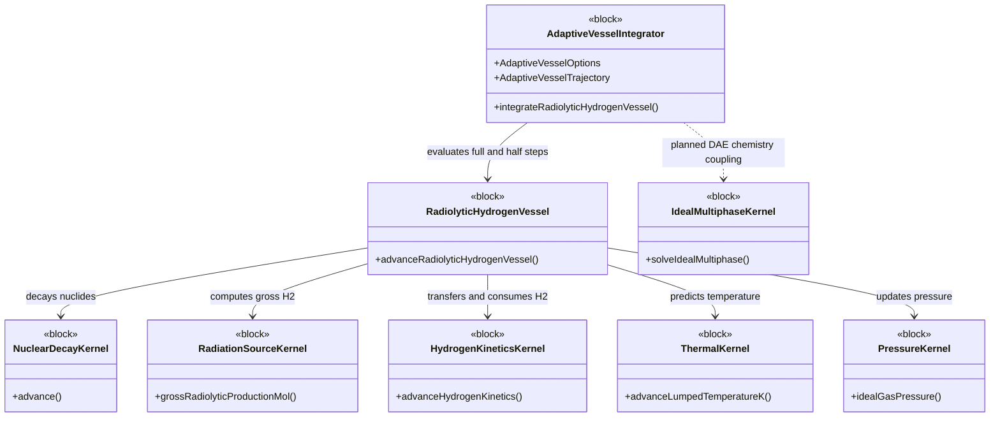

# BDD-like view — software component definitions

This view uses the **SysML v1 Block Definition Diagram** visual vocabulary.
The formal source counterparts are the `part def` elements in
[RadioThermochemicalArchitecture.sysml](../RadioThermochemicalArchitecture.sysml)
and [TimeIntegrationConnections.sysml](../TimeIntegrationConnections.sysml).

**Implemented:** solid-line dependencies; dotted dependence to the ideal
multiphase kernel is a **future integration**, not a currently invoked solver.
This is a software architecture BDD, not a physical vessel layout.
