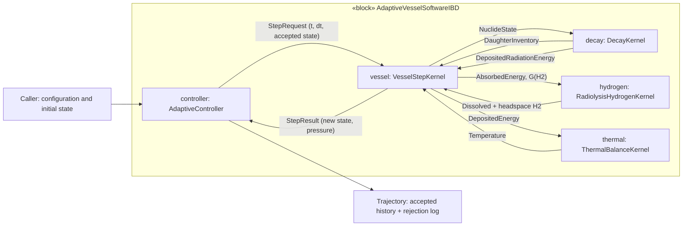

# IBD-like view — internal parts, ports and exchanges

Corresponds to the SysML v1 **Internal Block Diagram** (IBD) concerns:
part usages, interfaces, and item flows. Textual source:
[TimeIntegrationConnections.sysml](../TimeIntegrationConnections.sysml).

| Exchange | Units / semantics | Source API |
| --- | --- | --- |
| State and step duration | seconds, K, moles, atoms | `adaptive_vessel_integration.h` |
| Nuclide state | atoms by nuclide ID | `decay_network.h` |
| Radiation deposition | J by phase | `decay_network.h` |
| Gross H2 | mol over interval, *not* net pressure gas | `radiolysis_sources.h` |
| Dissolved / gas H2 | mol per reservoir | `hydrogen_kinetics.h` |
| Thermal result | temperature K | `lumped_thermal.h` |
| Pressure | Pa, ideal gas | `vessel_simulation.h` |

These are **numerical software interfaces**, not fluid ports, pipes, or mass
transfer geometries. Connector payloads in the SysML source are intentionally
coarse **conceptual item types**, not complete generated C++ bindings.
