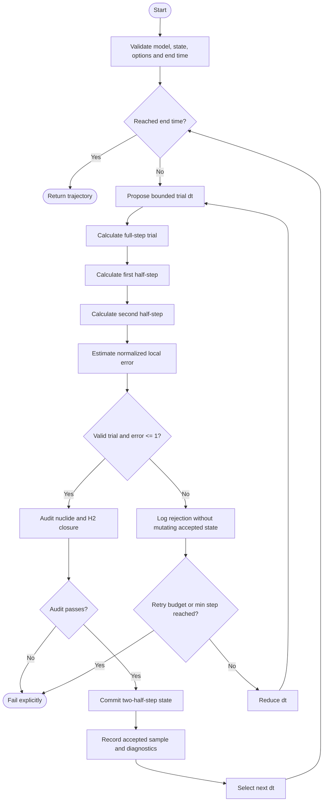

# ACT-like view — adaptive step execution

This is the **SysML v1 Activity Diagram** analogue. The SysML v2 action
definitions are in [TimeIntegrationBehavior.sysml](../TimeIntegrationBehavior.sysml).

The accepted state is immutable during a trial. Errors from invalid
physical configuration fail immediately. Only local truncation error and
explicitly retryable numerical issues trigger step reduction.
