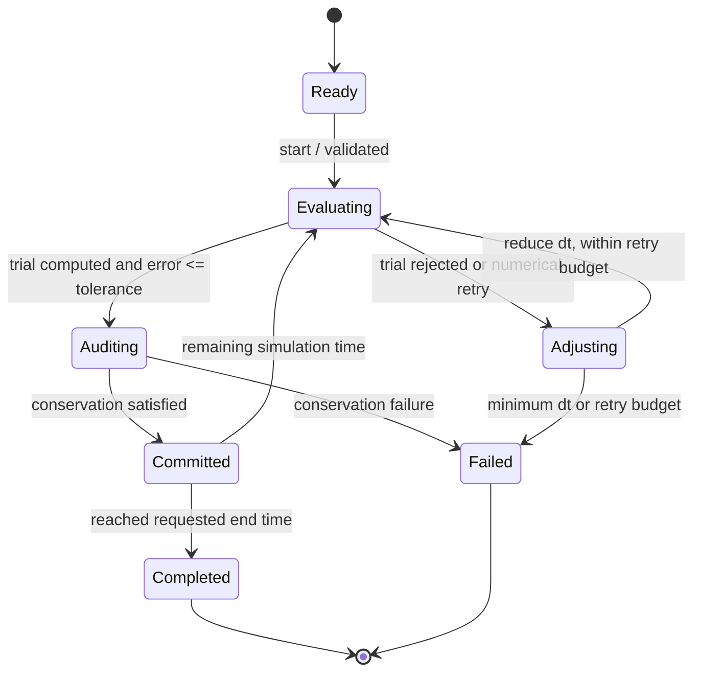

# STM-like view — adaptive controller lifecycle

The **SysML v1 State Machine Diagram** counterpart maps to
`state def AdaptiveTimeControllerStates` in
[TimeIntegrationBehavior.sysml](../TimeIntegrationBehavior.sysml).

| State | Invariant / responsibility |
| --- | --- |
| Ready | Input configuration validated; initial state not modified |
| Evaluating | Full and two half-step candidates calculated from same accepted state |
| Auditing | Nuclide and H2 conservation checked |
| Adjusting | A rejected trial does **not** update accepted state |
| Committed | Two-half-step result becomes the accepted state |
| Completed | Exact requested end-time sample available |
| Failed | Throws; no falsely successful partial trajectory returned |

The state diagram is a behavioral **design view**. The C++ implementation
currently realizes these conditions through its control flow, not a runtime
state-machine engine.
