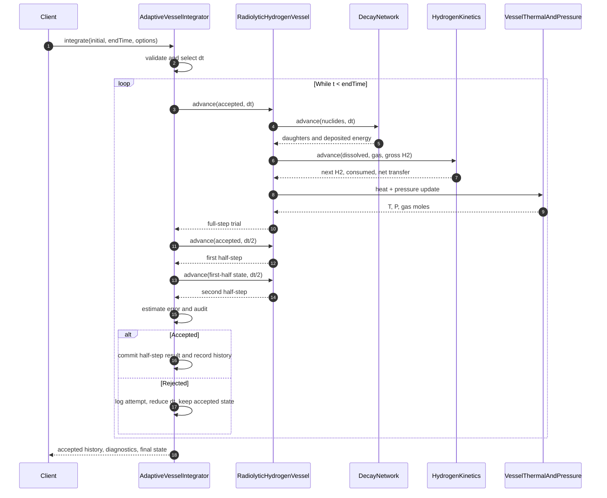

# SD-like view — one adaptive trial

This is the **SysML v1 Sequence Diagram** analogue. It shows calls and
results rather than implementing UML Interaction objects.

There is no GUI, asynchronous message queue, or separate parallel physics
workers. The calls are synchronous C++ calculations. At present the
underlying vessel step itself computes decay twice for its thermal path;
a future refactor may eliminate this duplicated internal call.

## Accepted-step chemistry call sequence

When the optional coupling wrapper is used, the adaptive controller calls
its accepted-state observer before committing a candidate. That observer
maps nuclide counts to elemental moles, removes absent components/species,
calls the ideal fluid/multiple-pure-solid equilibrium solver, and audits
mass conservation. A chemistry exception aborts. See the
[extended sequence](09-chemistry-time-coupling.md).
