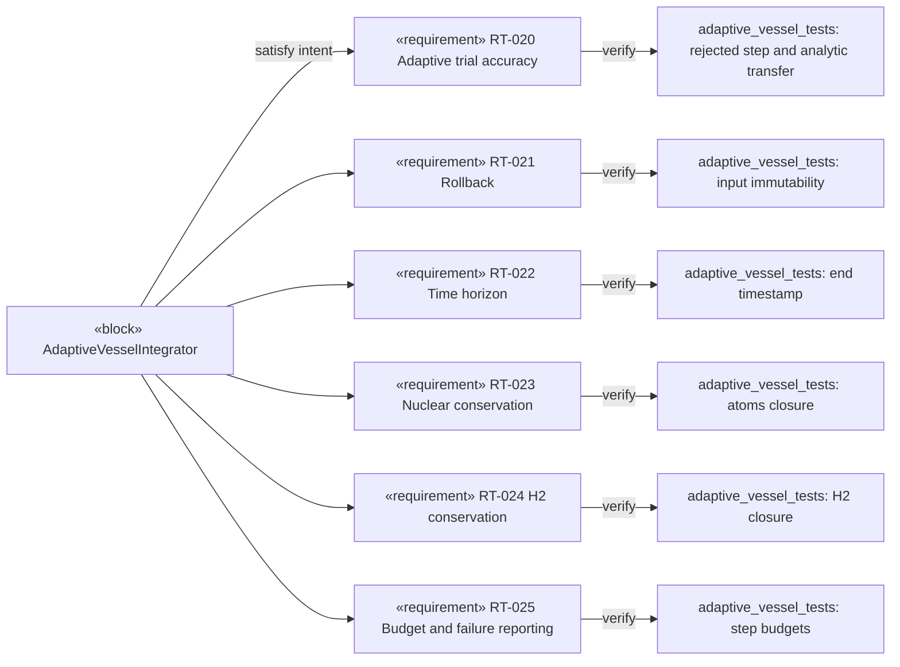

# REQ-like view — time integration and verification

Corresponds to SysML v1 **Requirement Diagram**. Candidate textual
requirement definitions are in
[TimeIntegrationRequirements.sysml](../TimeIntegrationRequirements.sysml);
test-level evidence and finite-precision criteria are in
[requirements-traceability.md](../requirements-traceability.md).

The diagram records software-test evidence, **not** experimental validation
of radioactive chemistry, thermodynamic models, or radiolysis yields.
