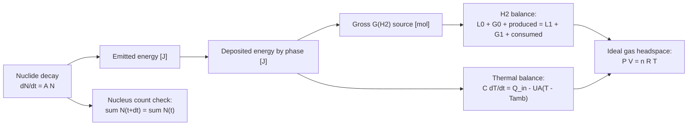

# PAR-like view — integrated numerical contracts

This view reflects the SysML v1 **Parametric Diagram** concern:
equations and conserved quantities. It is a design-level representation,
not a parsed executable SysML constraint model.

Actual numerical acceptance tests are **scaled**: local trial error
`max_j |x_full,j - x_half,j| / (absTol_j + relTol*max(|x_full,j|, |x_half,j|)) <= 1`.
The controller audits H2 inventory plus the explicit unmodeled consumption
pool, and nuclide **nucleus counts** (not chemical elements, which change
on decay). It does not yet close the entire atom balance across all radiolytic
reaction products or the full thermochemical energy balance.
