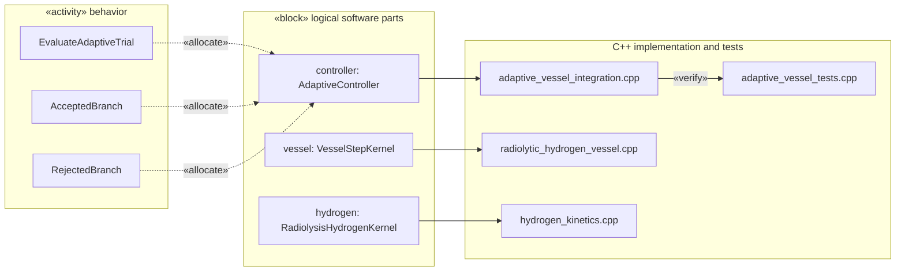

# Allocation view — behavior, software parts and C++ evidence

This view is the **functional allocation** concern familiar from SysML v1
«allocate» relationships. Textual source:
[TimeIntegrationAllocations.sysml](../TimeIntegrationAllocations.sysml).

The SysML v2 `allocation` usages allocate control-flow behavior to
the logical controller part. The dotted links are *architectural mappings*,
not measured execution times or verified generated bindings. The
implementation files and C++ test are the currently available evidence.
