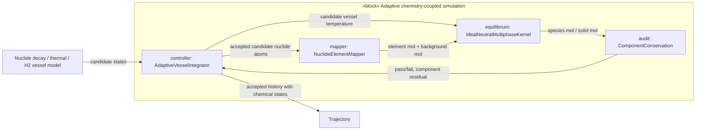
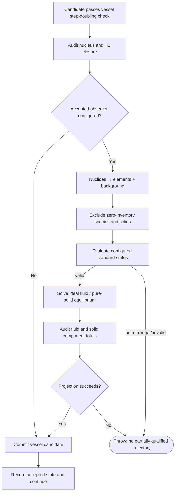
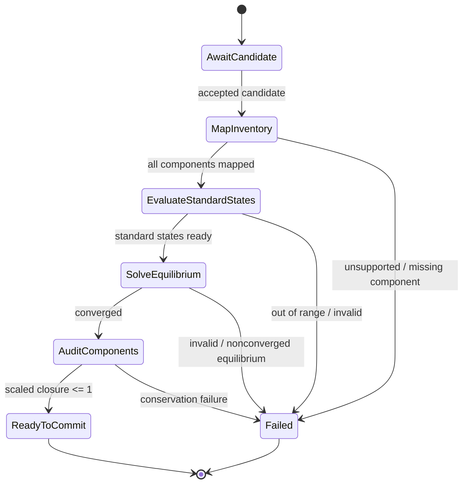
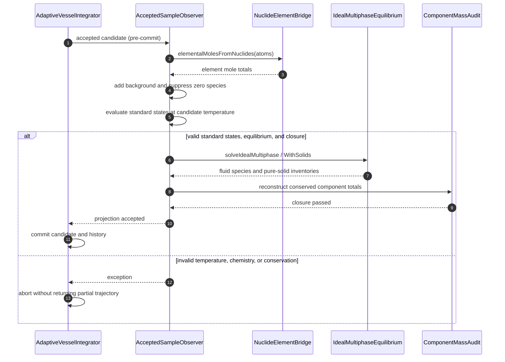

# Accepted-state chemical coupling: IBD / ACT / STM / sequence

This optional variant extends the adaptive vessel controller. It is a
**one-way chemical equilibrium projection** of accepted radionuclide states,
not a fully implicit chemical/thermal/radiolysis DAE. The source architecture
is [ChemistryTimeCoupling.sysml](../ChemistryTimeCoupling.sysml).

## IBD-like connected parts and item flows

No reverse arrow exists from `equilibrium` back to vessel heat, pressure,
decay, or radiolytic gas kinetics. No charged-species flow is supported.

## Activity-like decision flow

Rejected vessel **numerical** trial steps never enter this flow.

## State-machine-like failure handling

## Sequence-like callback and numerical library interactions

**Verification:** `tests/time_dependent_chemistry_tests.cpp` and
`tests/adaptive_vessel_tests.cpp`. These verify a numerical interface,
not scientifically validated radioisotope phase chemistry.
